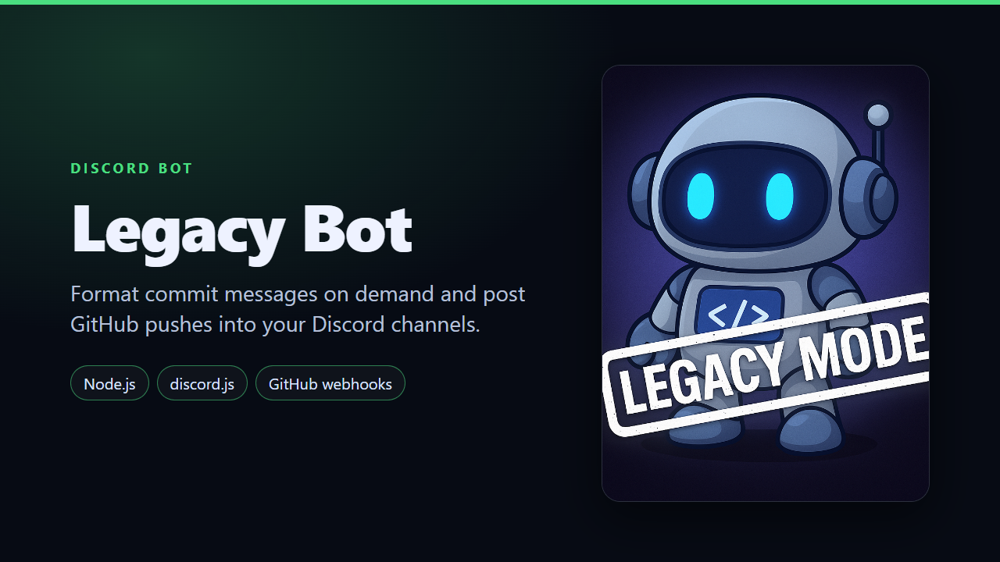

<h1 align="center">Legacy Bot</h1>

<p align="center">
  
</p>

<p align="center">[](https://github.com/PHTMGatt/Discord-Legacy-Bot/actions/workflows/ci.yml)</p>

<p align="center">
  Commit formatter + GitHub push alerts. One Discord bot for code chatter: format commit messages on demand, and post GitHub pushes into your channels.
  This bot replaces the separate <strong>Discord-WebHook-Bot</strong> (Captain Hook).
</p>

> **Merged.** Captain Hook's job (GitHub push → Discord, optional GPT cleanup) now lives here as `/watch`. The old Discord-WebHook-Bot repo (no longer on GitHub) is superseded by this one.

---

## 💡 Commands

| Command | Who | What it does |
| --- | --- | --- |
| `/commit text:<raw>` | anyone | Formats text as a clean commit line |
| `/watch repo:owner/name` | Manage Channels | Posts that repo's GitHub pushes into this channel |
| `/unwatch repo:owner/name` | Manage Channels | Stops it |
| `/watching` | anyone | Lists repos posting into this channel |
| `/legacymode enabled:<bool>` | Manage Channels | Legacy mode: every message in the channel is rewritten as `✅ name committed:` (opt-in, off by default) |

Push alerts look like:

```
**owner/repo**
🪝 bryen pushed: Updated docs and polished css layout
```

Messages never ping `@everyone`/`@here`, and commit text can't break out of code fences.

<p align="center">
  
</p>

---

## ⚙️ Setup

1. Create a bot in the [Discord developer portal](https://discord.com/developers/applications). Under **Bot**, enable the **Message Content** intent (needed for Legacy mode) and copy the token.
2. Invite it with scopes `bot` + `applications.commands` and permissions View Channel, Send Messages (add Manage Messages if you want Legacy mode to delete the original).
3. Configure environment variables (see below).
4. Run it.

### Environment variables

Set these in a git-ignored `.env` file or the process environment. **Secrets live only in env, never in git.**

| Variable | Required | Used for |
| --- | --- | --- |
| `DISCORD_TOKEN` | yes | Bot login |
| `GITHUB_WEBHOOK_SECRET` | for push alerts | Verifies GitHub's `X-Hub-Signature-256`. If unset, `/github` answers 503 and refuses everything |
| `DISCORD_GUILD_ID` | no | Register slash commands to one server (instant) instead of globally (can take up to an hour) |
| `OPENAI_API_KEY` | no | Enables GPT commit cleanup (paid). Without it a free local formatter is used |
| `OPENAI_MODEL` | no | Defaults to `gpt-4o-mini` |
| `PORT` | no | Defaults to `3000` |
| `DATA_DIR` | no | Where `store.json` (channel ids only, no secrets) is kept. Defaults to `./data` |

Migrating from the old bots: `DISCORD_TOKEN_LEGACY` is now `DISCORD_TOKEN`. The webhook registry (`webhooks.json`, which held secret webhook URLs) is gone: the bot posts with its own token, so just run `/watch` per channel.

### GitHub webhook

In the repo: **Settings → Webhooks → Add webhook**

- Payload URL: `https://<your-host>/github`
- Content type: `application/json`
- Secret: the same value as `GITHUB_WEBHOOK_SECRET`
- Events: **Just the push event**

Then run `/watch repo:owner/name` in the channel that should receive alerts.

---

## 🚀 Run locally

Requires Node 20+.

```bash
npm install
npm start      # Discord login + web server (status page, /healthz, /github)
npm test       # unit tests (also run by CI)
```

Health check: `GET /healthz`.

---

## 🥧 Deploy on a Raspberry Pi

> **Recommended: use the [raspbi-pilot](https://github.com/PHTMGatt/raspbi-pilot) installer** (one `sudo ./install.sh` sets up this bot and War Oracle as hardened services from `main`). Do not also follow the manual steps below, or you will end up with two installations.
>
> Before the first start on a Pi:
> - In the Discord Developer Portal, open this bot's app, go to **Bot** and turn on the privileged **Message Content Intent**. Without it the bot cannot log in ("Used disallowed intents").
> - **Stop any other copy of this bot** (for example on your PC). Two copies with the same token answer every command twice.
> - Leave `DATA_DIR` unset under the raspbi-pilot service: its unit only lets the bot write to its own `data/` folder.

Manual install (alternative):

```bash
# Node 20+ (e.g. via NodeSource), then:
git clone -b claude-forge https://github.com/PHTMGatt/Discord-Legacy-Bot.git
cd Discord-Legacy-Bot
npm ci --omit=dev
nano .env          # DISCORD_TOKEN, GITHUB_WEBHOOK_SECRET, ... (chmod 600 .env)
```

Run it as a service, `/etc/systemd/system/legacy-bot.service`:

```ini
[Unit]
Description=Legacy Discord Bot
After=network-online.target
Wants=network-online.target

[Service]
WorkingDirectory=/home/pi/Discord-Legacy-Bot
ExecStart=/usr/bin/node src/index.js
EnvironmentFile=/home/pi/Discord-Legacy-Bot/.env
Restart=always
RestartSec=5
User=pi

[Install]
WantedBy=multi-user.target
```

```bash
sudo systemctl daemon-reload
sudo systemctl enable --now legacy-bot
journalctl -u legacy-bot -f
```

GitHub must reach `/github` from the internet. Easiest and safest from a home Pi: a [Cloudflare Tunnel](https://developers.cloudflare.com/cloudflare-one/connections/connect-networks/) (or similar) to `http://localhost:3000`, so no router ports are opened. Slash commands and Legacy mode need no inbound access.

Back up `data/store.json` if you care about watched repos (it is just channel ids).

---

<p align="center" style="font-size: 0.9rem; color: #666;">
  Developed and maintained by <strong>Bryen Gatt</strong> • MIT License
</p>
