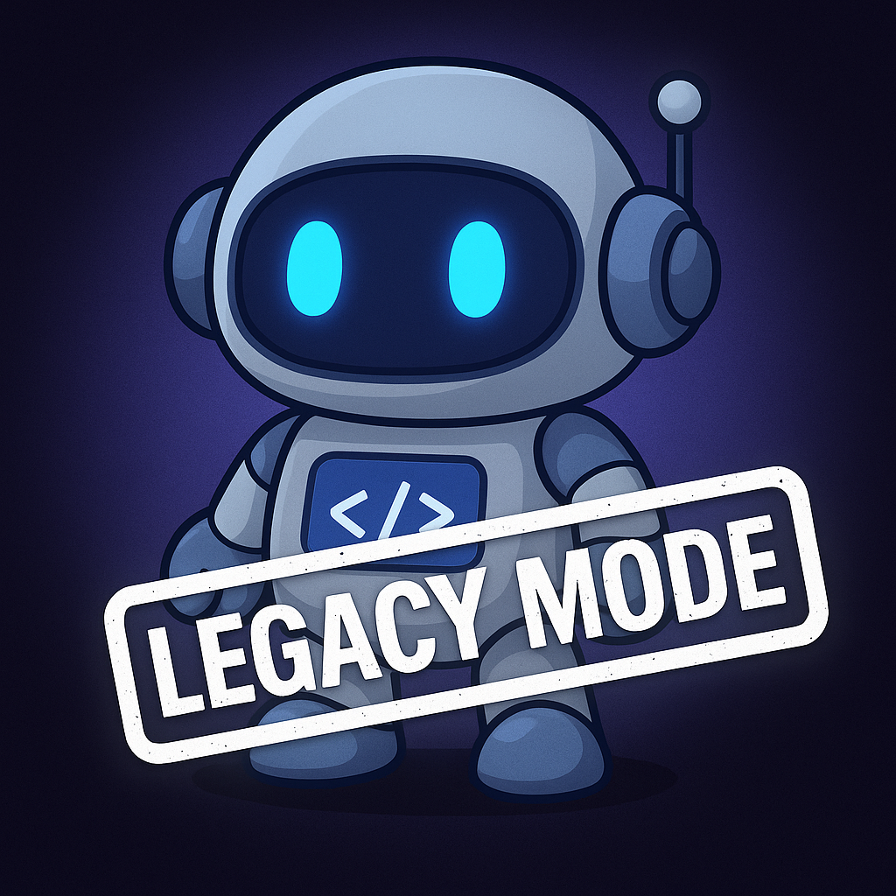
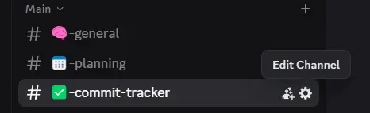

<h1 align="center">📦 Legacy Mode: Commit Formatter Bot</h1>

<p align="center">
  
</p>

<p align="center">
  A lightweight Discord bot designed for simple, fun commit message formatting inside your server.  
  Trigger it with keywords and enjoy charming commit summaries on demand.
</p>

---

## 💡 Features

- 🧠 Responds to short keywords (e.g., `readme`)
- 📝 Formats commit-style responses in real time
- 💬 Keeps your channels tidy and fun
- 🔒 Only posts in channels where it has permission

---

## ⚙️ How It Works

When a user types:

```
readme
```

The bot replies:

```
✅ [Bryen] dropped a lil mimmit: `Readme`
```

---

## 🚀 Setup Instructions

1. [Invite the Bot to Your Server](https://discord.com/oauth2/authorize?client_id=1372387773062844436&scope=bot&permissions=0)
2. Navigate to your target **channel settings**
3. Under **Permissions**, add the bot to **Roles/Members**
4. Enable the following permissions:
   - ✅ Send Messages
   - ✅ Manage Messages

> ✅ The bot will only respond where explicitly authorized.

---

## 📸 Demo

<p align="center">
  
</p>

---

## 🚀 Run Locally

**Status:** maintained. Requires Node 18+. The bot needs the **Message Content** intent enabled in the Discord developer portal.

```bash
npm install
npm start      # web status page on PORT (default 3000) + Discord login
npm test       # syntax check (also run by CI)
```

Create a `.env` file (git-ignored). Names only:

| Variable | Used for |
| --- | --- |
| `DISCORD_TOKEN_LEGACY` | Bot login (required) |
| `PORT` | Optional. Defaults to `3000` |

Health check: `GET /healthz`.

---

## 🌐 Deployment Notes

Hosted on Render:  
```
https://discord-legacy-bot.onrender.com
```

- 🔁 Run as a **Background Worker** for continuous uptime

---

<p align="center" style="font-size: 0.9rem; color: #666;">
  Developed and maintained by <strong>Bryen Gatt</strong> • MIT License
</p>
