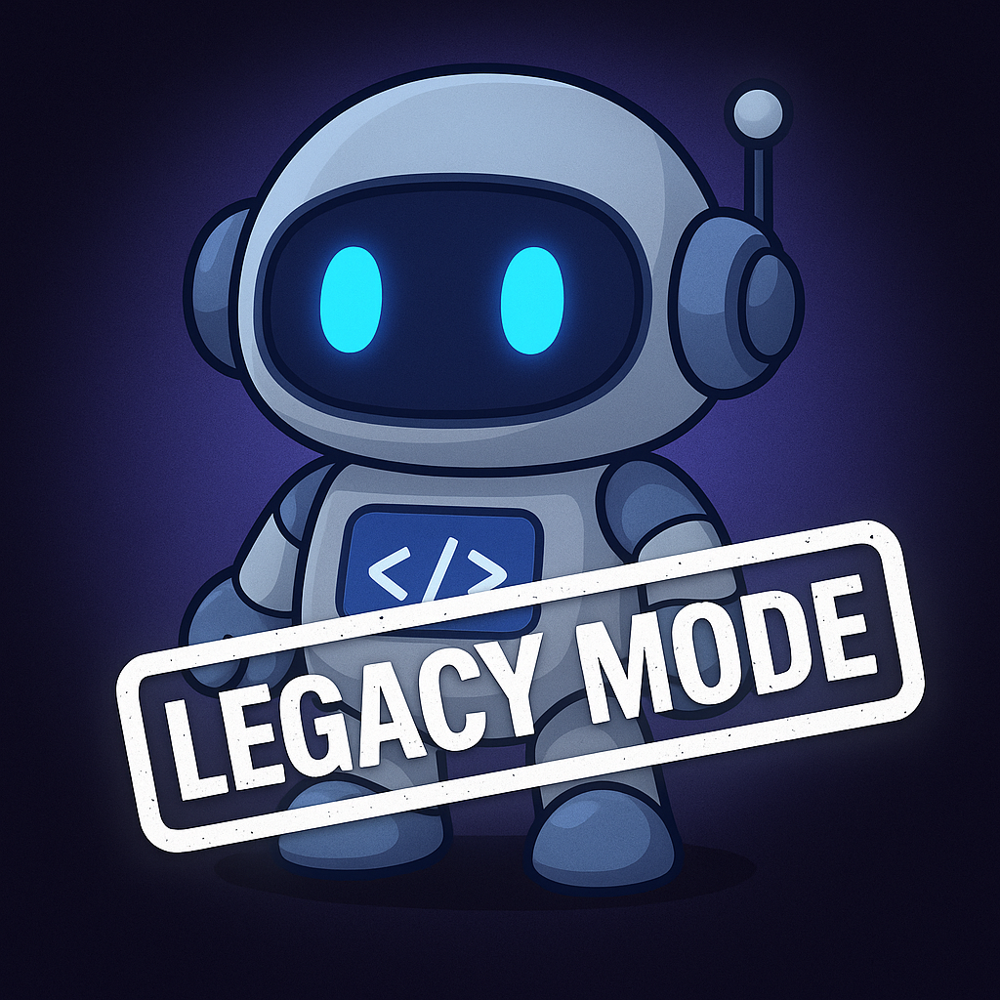
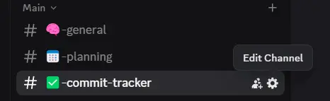

<h1 align="center">📦 Legacy Mode: Commit Formatter Bot</h1>

<p align="center">
  
</p>

<p align="center">
  A lightweight Discord bot designed for simple, fun commit message formatting inside your server.  
  Trigger it with keywords and enjoy charming commit summaries on demand.
</p>

---

## 💡 Features

- 🧠 Responds to short keywords (e.g., `readme`)
- 📝 Formats commit-style responses in real time
- 💬 Keeps your channels tidy and fun
- 🔒 Only posts in channels where it has permission

---

## ⚙️ How It Works

When a user types:

```
readme
```

The bot replies:

```
✅ [Bryen] dropped a lil mimmit: `Readme`
```

---

## 🚀 Setup Instructions

1. [Invite the Bot to Your Server](https://discord.com/oauth2/authorize?client_id=1372387773062844436&scope=bot&permissions=0)
2. Navigate to your target **channel settings**
3. Under **Permissions**, add the bot to **Roles/Members**
4. Enable the following permissions:
   - ✅ Send Messages
   - ✅ Manage Messages

> ✅ The bot will only respond where explicitly authorized.

> ⏸️ The hosted bot is offline for now because its Render service is suspended. The invite still works, but the bot will not reply until the service is resumed. To use it today, run your own copy with your own bot token (see Run Locally).

---

## 📸 Demo

<p align="center">
  
</p>

---

## 🚀 Run Locally

**Status:** maintained. Requires Node 18+. The bot needs the **Message Content** intent enabled in the Discord developer portal.

```bash
npm install
npm start      # web status page on PORT (default 3000) + Discord login
npm test       # syntax check (also run by CI)
```

Create a `.env` file (git-ignored). Names only:

| Variable | Used for |
| --- | --- |
| `DISCORD_TOKEN_LEGACY` | Bot login (required) |
| `PORT` | Optional. Defaults to `3000` |

Health check: `GET /healthz`.

---

## 🌐 Deployment Notes

Deployed on Render as a web service (status page and bot in one process):
```
https://discord-legacy-bot.onrender.com
```

- ⏸️ The service is currently **suspended**, so that URL and the bot stay offline until it is resumed.

---

<p align="center" style="font-size: 0.9rem; color: #666;">
  Developed and maintained by <strong>Bryen Gatt</strong> • MIT License
</p>
